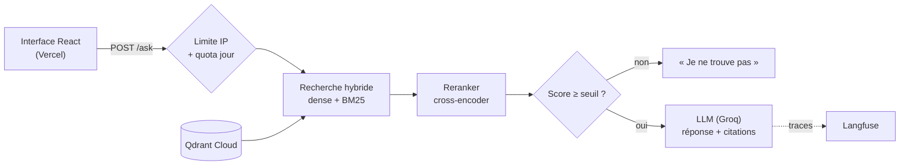

# Le Classeur — assistant documentaire qui cite ses sources ou dit qu'il ne sait pas

> Étude de cas prête à coller dans l'administration (Projets › Nouveau projet). Chaque chiffre vient d'un script du dépôt `ItxMveng/policy-binder` (fichiers de `eval/results/` et rapport `docs/evaluation.md`).

**Description courte (carte)** : Assistant RAG qui répond aux questions sur des règlements en citant la page exacte du document officiel, et qui dit « je ne trouve pas » quand la réponse n'y est pas. Évalué sur 60 questions, déployé sur Azure et évalué en CI à chaque changement.

## Problème
Dans une entreprise ou un établissement public, les règles internes (règlement intérieur, procédures, chartes informatiques, règles d'examen) sont réparties dans des dizaines de PDF. Pour une question simple, un collaborateur ouvre plusieurs documents ou sollicite un service support, et obtient parfois une réponse fausse. Un assistant conversationnel peut réduire ce coût, mais un assistant qui invente une règle est pire que pas d'assistant. Le Classeur est construit autour de deux exigences mesurées : citer la page exacte, et dire quand l'information n'est pas dans les documents.

## Approche
- **Corpus** : 9 documents publics de l'ENIB / Bretagne INP, de l'Université de Brest et d'IMT Atlantique, qui jouent le rôle de politiques internes. Ils sont découpés en 546 passages qui ne traversent jamais une page, pour que chaque citation renvoie à une page précise.
- **Recherche en deux étages** : recherche hybride (embeddings multilingues dans Qdrant + BM25, fusion par rang), puis reranking des 20 candidats par un cross-encoder exécuté en local.
- **Abstention à deux niveaux** : un seuil sur le score du reranker, calibré sur un jeu de questions séparé, s'abstient sans appeler le LLM ; le LLM s'abstient aussi si les passages ne suffisent pas.
- **Questions sur plusieurs établissements** : recherche par établissement, réponse partie par partie, et mention explicite de la partie absente des documents.
- **Évaluation** : 60 questions écrites comme un utilisateur et validées à la main (40 avec réponse, 20 hors corpus), un juge LLM d'une autre famille de modèles, des intervalles de confiance, et une comparaison avec une base naïve. 20 questions tournent en CI et bloquent sous des seuils fixés à l'avance.
- **Production** : API FastAPI conteneurisée sur Azure Container Apps (Terraform, déploiement GitHub Actions sans mot de passe par OIDC), index sur Qdrant Cloud, interface React sur Vercel, traces Langfuse, limite de questions par adresse et par jour.

## Architecture

## Résultats (mesurés)
Sur les 60 mêmes questions, même modèle et même juge (intervalle de confiance à 95 %) :
- **Exactitude** : 70 % (IC 55–82 %) pour la version finale, contre 42,5 % (IC 29–58 %) pour la base naïve (recherche dense seule).
- **0 réponse incorrecte** sur 40 questions avec réponse (2 pour la base naïve).
- **20/20 abstentions** sur les questions hors corpus, dont 15 sans appel au LLM.
- **Bonne page retrouvée** parmi les passages fournis : 95 %, contre 62,5 %.
- **Coût** : 0,25 $ pour 1 000 questions (tarif public Groq).
- **Latence de la démo en ligne** : médiane 8,2 s (6 questions, 16/10/2026), due au reranker sur CPU.
- **Questions sur deux ou trois établissements** (8 questions, 17 parties) : 8 parties sur 10 répondues et citées, contre 1 sur 10 avant la correction ; 7 parties absentes des documents sur 7 signalées comme telles, sans réponse affirmée pour aucune d'elles.

Les résultats sont exploratoires : 40 questions avec réponse donnent des intervalles larges.

## Démo / lien
- Démo : https://policy-binder.vercel.app
- Code, rapport d'évaluation et journal de bord : https://github.com/ItxMveng/policy-binder

## Stack
Python 3.12 · FastAPI · Qdrant (Qdrant Cloud) · fastembed (embeddings multilingues et reranker bge-reranker-v2-m3) · BM25 · Groq (gpt-oss-120b) · Langfuse · React · Vite · TypeScript · Docker · Terraform · Azure Container Apps · Vercel · GitHub Actions · pytest.

## Limites et suite
- **Latence** d'environ 8 s, presque entièrement due au reranker sur CPU. Pistes à mesurer : GPU, reranker plus petit, passages plus courts.
- **Jeu d'évaluation modeste** : 60 questions sur 9 documents. Un jeu jamais vu, idéalement de vraies questions d'utilisateurs, confirmerait les chiffres.
- **Hébergement** sur Azure for Students au lieu de Google Cloud Run, faute de compte de facturation. Le Terraform Cloud Run est prêt et validé en CI.
- **Suite** : suivre la qualité en production à partir des traces, et mettre à jour le corpus automatiquement quand un établissement publie une nouvelle version d'un document.
